<div align="center">

# 🛡️ FedShield

### Federated mule-account intelligence for Indian banks

**Banks train one mule-detection model together, without sharing a single customer record.**

<p>
  
  
  
  
</p>

<p>
  <a href="#-results">Results</a> •
  <a href="#%EF%B8%8F-how-it-works">How it works</a> •
  <a href="#-tech-stack">Tech stack</a> •
  <a href="#-quick-start">Quick start</a> •
  <a href="#-demo-personas">Demo</a> •
  <a href="#%EF%B8%8F-deployment">Deployment</a> •
  <a href="#-documentation">Docs</a>
</p>

</div>

---

## 💡 The problem

Mule accounts move fraud money **across** banks, but each bank can only see **its own** accounts. Pooling data
to catch them is ruled out by privacy law and bank secrecy, so every bank fights the same network alone.

**FedShield closes that gap:**

| | |
|---|---|
| 🏦 **Data stays home** | Each bank keeps its raw data. It sends only **masked gradient histograms**. |
| 🔒 **Blind aggregator** | A neutral aggregator can decode only the **sum** across banks, never any one bank's histogram. |
| 🧩 **Hashed registry** | A shared suspect registry links accounts across banks using **HMAC digests**, without revealing identities. |
| 🚧 **Malicious-bank gates** | Two gates detect and exclude a bank that poisons the model. |
| 👁️ **Role-scoped views** | Bank officers, the aggregator and the RBI desk each see only what their role allows. The server enforces it. |

Built on the **RBIH NFPC Phase-2** data (96,091 labelled accounts, 398M transactions). **IBM AMLworld** and **BAF**
plug into the same core through one adapter contract.

---

## 📊 Results

> NFPC Phase-2 · 96,091 labelled accounts · 3 banks simulated by splitting accounts by state · leak-free features

### FedShield matches pooled training without pooling the data

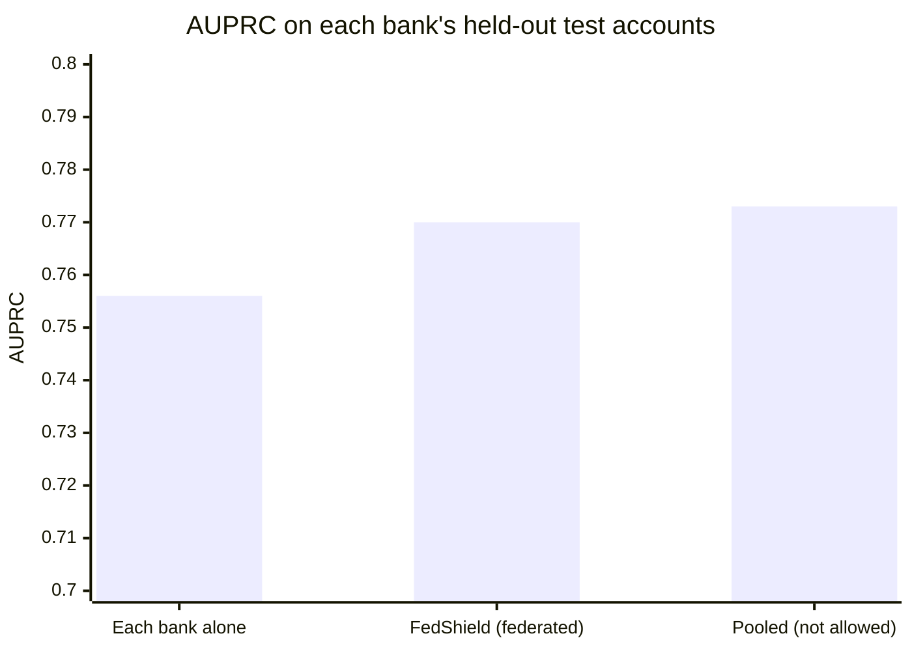

| Model | AUPRC | Data shared |
|---|:---:|:---:|
| Each bank alone (mean, own test accounts) | 0.756 | none |
| **FedShield** (secure aggregation + gates + registry) | **0.770** | **none** |
| Centralised: all data pooled | 0.773 | everything (not legally possible) |

**Final model, held-out test:** AUC **0.945** · AUPRC **0.769** · precision **0.83** · recall **0.81** · F1 **0.82**.
Of the top 1% of accounts by score, **87% are mules**.

### The smallest bank gains the most

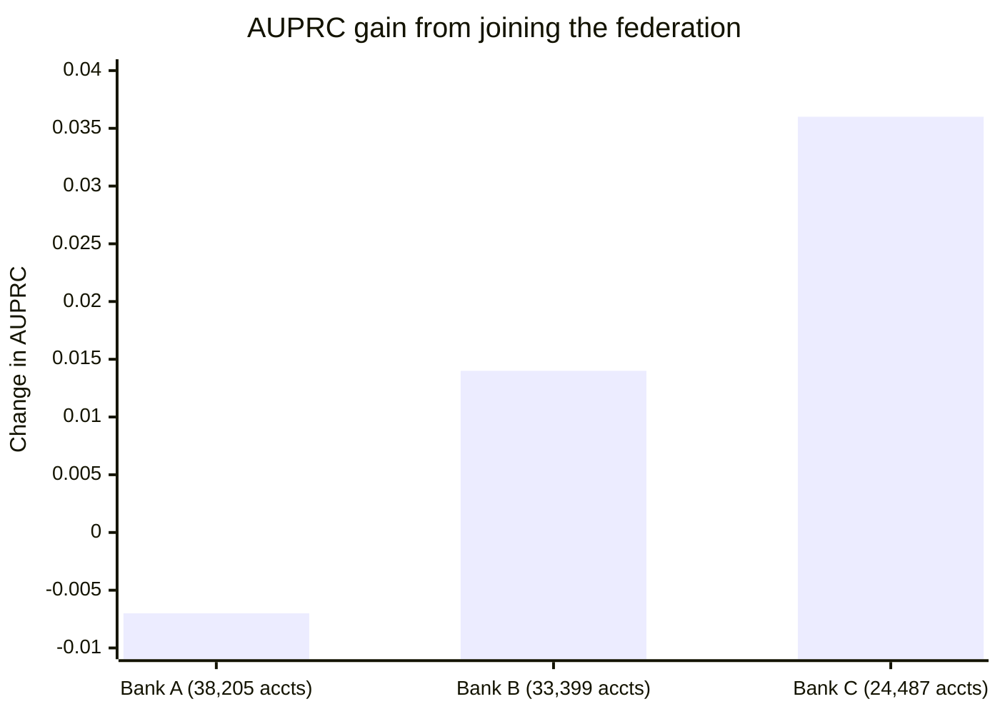

- **37 more mules caught** on held-out accounts that the banks' own models missed, against 6 that local models caught and federation missed (**net +31**).
- **Stable over seeds:** FedShield beats local-only in all 3 seeds (+0.008 to +0.030).
- **Banks with different fraud patterns:** FedShield 0.781 vs centralised 0.782.

### A malicious bank can't break it

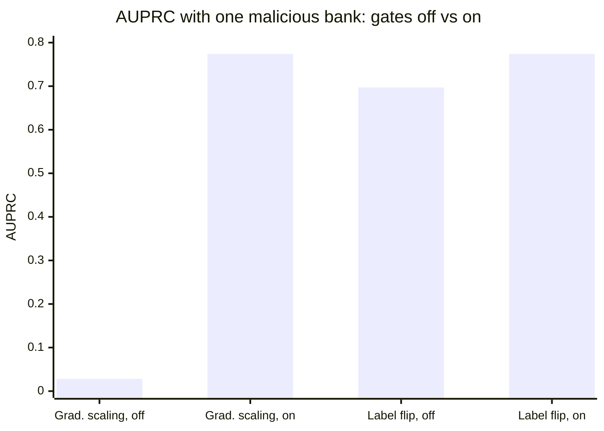

### Trustworthy labels and features

**Label shield.** 1,907 doubtful mule labels are down-weighted, not deleted:

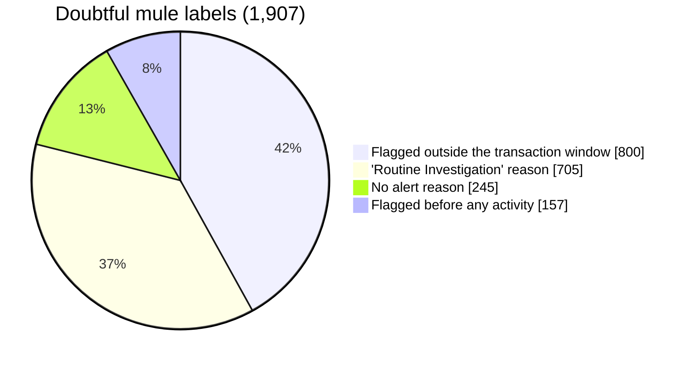

**Leakage check** (`experiments/leakage.py`):
- `days_since_kyc` turned out to be a label proxy: re-KYC after an account was flagged lifted static-only AUPRC from 0.38 to 0.68. It is now blocked.
- With transaction features recomputed from only the data before each cutoff date: **0.896** against 0.920 full-window (sample with an 18% mule rate).

**Fairness:** the highest false-positive rate is at most **1.63×** the lowest across rural, semi-urban and urban branches, and **1.04×** by gender.

### Honest limitation: differential privacy is expensive at this scale

On a smaller sweep model, AUPRC is 0.652 without DP and 0.198–0.221 at ε 16–64. We report this rather than hide it.

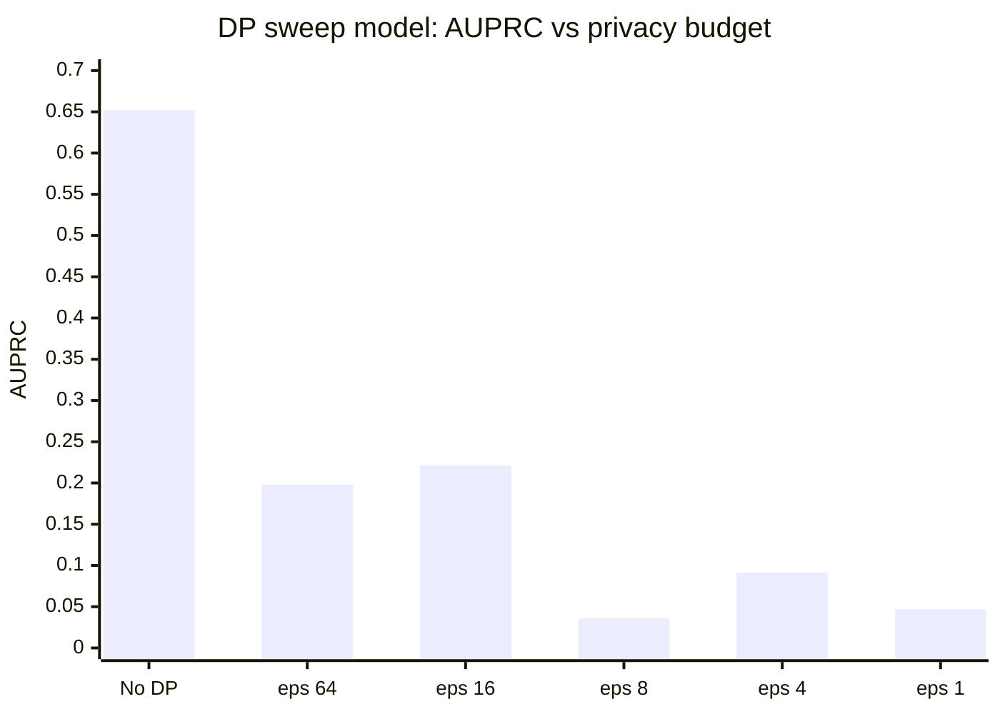

**Competition submission:** `results/submission/submission.csv` covers 64,062 test accounts. 1,776 are predicted mules, each with a suspicious window taken from its peak 7-day burst (median 10 days).

---

## 🧪 Stress tests and deployment evidence

> `python -m fedshield.experiments.gaps` · real NFPC features · compact model (60 trees, depth 5) · results in `results/gaps.json`

**Real cross-bank laundering chains** (IBM AMLworld HI-Small, `experiments/aml_chains.py`): 5 institutions, each seeing only transfers that touch its own accounts. Of 202 laundering chains spanning 3+ banks, judged only on held-out accounts:

| | Each bank alone | FedShield + registry |
|---|:---:|:---:|
| Chains interrupted (≥ 1 account flagged) | 60% | **81%** |
| Chain accounts flagged | 36% | **54%** |
| False alarms on clean accounts | 0.47% | **0.31%** |

45 chains are interrupted only by FedShield; 4 only by the banks alone. Account-level AUC-PR: banks alone 0.50–0.56, FedShield + registry **0.589**, pooled data 0.588.

**Banks are not identical.** Federation helps most where a bank's own data is worst:

| Scenario | Affected bank alone | With FedShield |
|---|:---:|:---:|
| Bank B lacks 41 of 174 features (different core-banking system) | 0.765 | **0.794** |
| Bank C measures every value with ±25% error | 0.732 | **0.784** |

**A small bank joins with almost no history** (`experiments/theatre.py`): with 25 labelled mules, Bank C alone reaches AUC-PR 0.526; in the network, **0.760** (with the min-cell privacy rule on).

**Min-cell privacy rule.** No released histogram cell may describe fewer than *k* accounts (`FedConfig.min_cell`). At k = 10 every bank is equal or better (it also regularises); at k = 50 the cost is at most 0.009.

**Three-condition alert engine** (canonical model, held-out, base rate 2.8%):

| Condition | Alerts | Precision | Recall |
|---|:---:|:---:|:---:|
| 1 · High model risk | 521 | 83% | 81% |
| 2 · Strong cross-bank link (rare counterparties shared with confirmed mules, top 3% of training accounts) | 603 | 24% | 27% |
| 1 and 2 (priority tier) | 165 | **84%** | 26% |
| 3 · Active I4C case | interface only (no public feed) | | |

A broad "2+ links to confirmed mules" rule was tested and **rejected**: it fires on 97% of accounts.

**As a MuleHunter add-on** (bank's own cross-fitted score as an input): +0.028 for the bank with the weakest own model, roughly neutral (−0.004, −0.008) where the own model is already strong. The network's larger value is the cross-bank signal and the cold start.

**Cost.** Full model ≈ 74 s for 3 banks on a laptop. Measured upload ≈ 631 MB per bank per model as raw float64 arrays (including zeroed cells for unsampled features; float32 + sparse sending would cut ~65%). Upload per bank does not grow with network size.

### Architecture vs the Stage-1 poster

The Stage-1 poster described 8 layers. The built system has **7 layers, each mapped to code** (see the *Deployment & trust* page). The poster's **cluster-distribution encoder (μ, Σ, w, t, v) was replaced** by lossless federated histogram boosting, and its 0.527 / 0.542 figures were not reproduced; the numbers above supersede them. Updated one-pager: [`docs/FedShield_onepager_v2.pdf`](docs/FedShield_onepager_v2.pdf).

---

## ⚙️ How it works

### System architecture

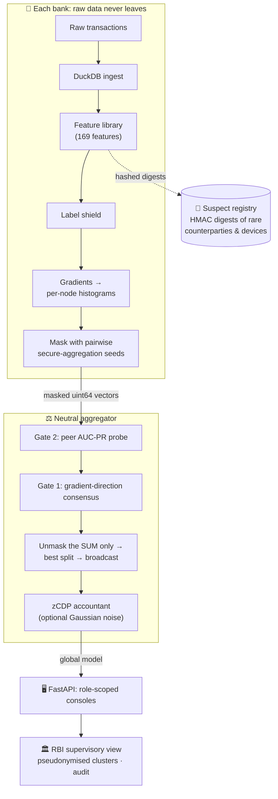

### One federated training round

The sum of the banks' histograms equals the pooled histogram. So the federated model is **lossless** against
centralised training on the same bins, and this is tested (`tests/test_core.py::test_federated_equals_pooled_with_same_bins`).

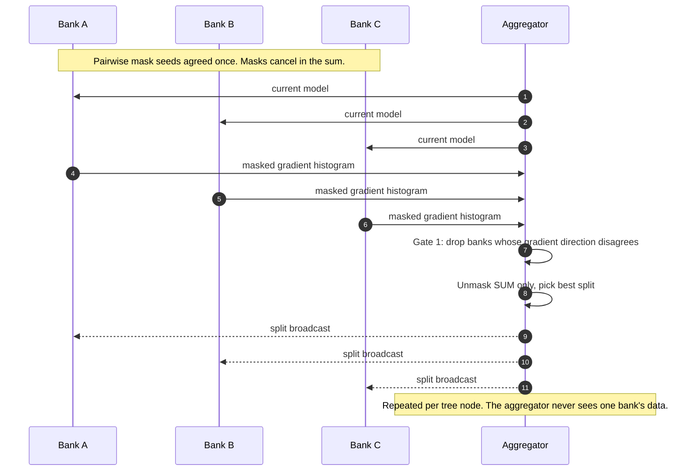

### Who sees what

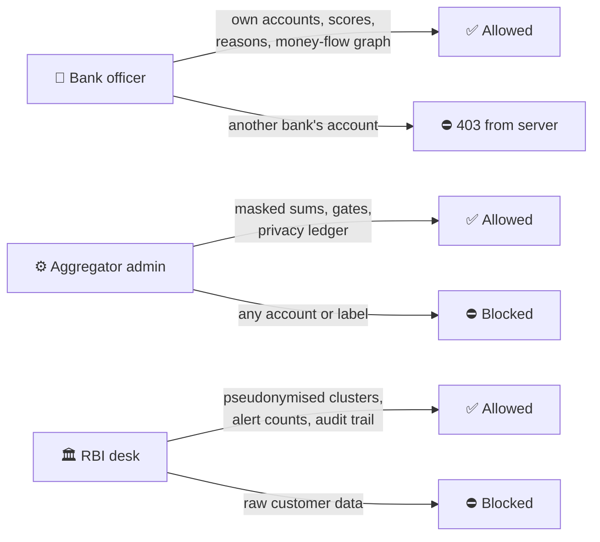

---

## 🧰 Tech stack

<div align="center">

**Data & ML**


**Backend & streaming**


**Frontend**


**Infrastructure**


</div>

### What's in the box

| Layer | Where | What it does |
|---|---|---|
| 📥 **Ingest** | `fedshield/ingest/` | DuckDB out-of-core ingest. NFPC: 398M transactions joined with `transactions_additional`, sharded by account |
| 🧪 **Features** | `fedshield/features/nfpc_v2.py` | MuleHunter feature families: rolling 1h/12h/1d/7d peaks, channel counts, burst ratios, concurrency, digit patterns, MCC outliers, unique counterparties. Batched, memory-capped, resumable |
| 🏷️ **Label shield** | `fedshield/features/nfpc_master.py` | Down-weights doubtful mule labels |
| 🚫 **Leakage guards** | `fedshield/adapters.py`, `experiments/leakage.py` | Freeze/flag/alert fields and `days_since_kyc` blocked; point-in-time re-extraction to verify |
| 🤝 **Federation** | `fedshield/fl/` | Histogram GBDT (numba), lossless against pooled training. Pairwise-masked secure aggregation, zCDP accountant, two Byzantine gates |
| 🧩 **Registry** | `fedshield/registry.py` | HMAC-hashed suspect registry of rare shared counterparties and devices; never the account's own label |
| 📚 **Patterns** | `fedshield/patterns/library.py` | Typology states (emerging / confirmed / dormant / retired) and versioned model snapshots |
| 🖥️ **API** | `fedshield/api/` | FastAPI with 5 role personas and **server-enforced scope**, explanations, ego graphs, audit log, live federation stream |
| 🌊 **Stream** | `fedshield/stream/` | Online scorer with a Redis feature store and a Redpanda producer/consumer (in-process fallback) |
| 🎨 **UI** | `ui/` | React + TypeScript + Tailwind + Cytoscape + Recharts |

---

## 🚀 Quick start

### Data pipeline

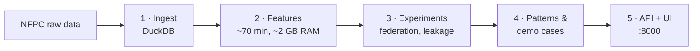

```bash
python -m venv .venv && .venv/Scripts/pip install -r requirements.txt     # Windows; use .venv/bin on Linux/Mac

# 1–2. data → features (≈ 70 min for NFPC on 8 threads, ~2 GB RAM)
python -m fedshield.ingest.nfpc
python -m fedshield.features.nfpc_v2 && python -m fedshield.features.nfpc_v2 --merge

# 3–4. experiments and artefacts
python -m fedshield.experiments.nfpc full
python -m fedshield.experiments.leakage
python -m fedshield.patterns.library full
python -m fedshield.experiments.demo_prep
python -m fedshield.experiments.submission

# 5. app
cd ui && npm ci && npm run build && cd ..
uvicorn fedshield.api.server:app --port 8000        # http://localhost:8000
```

> **Memory:** every heavy step goes through DuckDB with a cap (`FEDSHIELD_DUCKDB_MEM`, default 2–3 GB) and spills to `work/duckdb_tmp`.

### 🐳 Docker: the full consortium topology

```bash
python scripts/export_partitions.py     # each bank's private partition
docker compose up --build               # 3 bank nodes, aggregator, Redis, Redpanda, replayer, API/UI on :8000
```

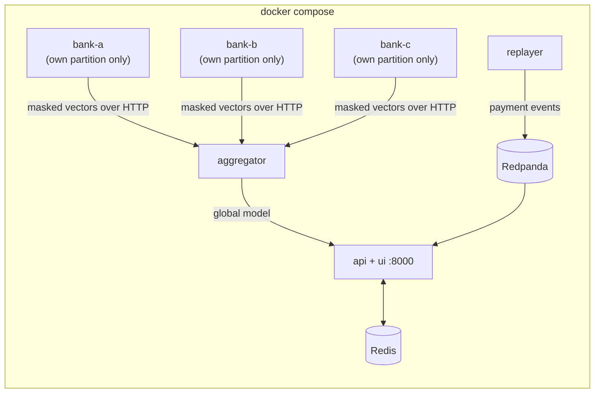

Each bank container mounts **only its own** partition. The aggregator talks to the banks over HTTP and only ever receives masked vectors.

### 📓 Kaggle

`python scripts/make_notebooks.py` writes `notebooks/01_nfpc_fedshield.ipynb`, `02_amlworld_fedshield.ipynb` and `03_baf_adapter.ipynb`.
Attach the dataset and this repo as a Kaggle dataset, then **Run All**. The notebooks call the same modules.

---

## 🎭 Demo personas

Password: the value of `FEDSHIELD_DEMO_PASSWORD` (default `fedshield` locally).

| User | Sees | Cannot see |
|---|---|---|
| `bank_a` · `bank_b` · `bank_c` | Own alerts, scores, explanations, money-flow graph (other banks' accounts hashed) | Any other bank's data. Try **Privacy probe**: the server returns 403 |
| `admin` | Live federation: packets, gates, privacy ledger, learning curve. Deploys the global model | Any account or label |
| `rbi` | Cross-bank clusters (pseudonymised), alerts by bank, pattern library, audit trail | Raw customer data or identities |

### ⏱️ Two-minute demo script

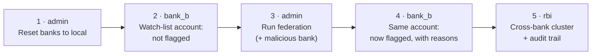

1. `admin` → **Reset banks to local**.
2. `bank_b` → pick an account from the **Watch list**. The local model scores it below its threshold, so it isn't flagged.
3. `admin` → **Run federation** (NFPC). Packets fly. Set a malicious bank and the gate excludes it. The model deploys when the run finishes.
4. `bank_b` → same account. The **Federation effect** panel shows local score → federated score, now flagged, with reasons.
5. `rbi` → the cross-bank cluster and the audit trail of the officer's action.

> The watch-list accounts are real held-out mules that the bank's own model missed and the federated model caught (`work/demo_cases.json`). Nothing is staged.

---

## ☁️ Deployment

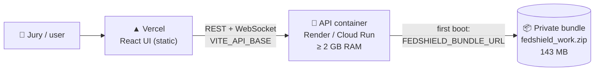

| Part | Host | Key settings |
|---|---|---|
| **UI** (`ui/`) | Vercel | Root Directory = `ui`, `VITE_API_BASE=https://<api-host>` (no trailing slash) |
| **API** | Render (`render.yaml`), Google Cloud Run, or any container host | `FEDSHIELD_BUNDLE_URL`, `FEDSHIELD_DEMO_PASSWORD`, `FEDSHIELD_SECRET`; at least 2 GB RAM, because a live federation run peaks at about 1 GB |

The API can't run on Vercel: it needs the model artefacts and long-lived WebSockets. The artefacts are **not in git**,
because they're derived from licensed competition data. Build them with `scripts/make_deploy_bundle.py` and serve them from a private direct-download link.
Full steps are in [docs/DEPLOYMENT.md](docs/DEPLOYMENT.md).

---

## 🔌 Add a dataset

```python
from fedshield.adapters import Prepared, adapter

@adapter("mybank")
def _mine():
    f = ...  # one row per account/application: feature columns + y, bank, split, entity
    return Prepared("mybank", "account", f, feature_names)
```

It immediately works in federation, gates, DP, evaluation, the live pipeline and the UI dataset picker.

---

## ⚠️ Honest limits

- Banks are **simulated** partitions of one dataset (by state). Real banks would differ more, which helps federation.
- EFRM, AML and I4C evidence feeds are **simulated** from labels, because no public data exists.
- Explanations are tree-path (Saabas) attributions, a fast approximation to TreeSHAP.
- Formal DP is only usable at loose budgets at this data size (see the DP sweep above).
- Demo auth is for demonstration: hardcoded personas and HMAC tokens, not an identity provider.

---

## 📚 Documentation

| Doc | What's inside |
|---|---|
| [docs/ARCHITECTURE.md](docs/ARCHITECTURE.md) | Protocol, modules, leakage policy, memory discipline |
| [docs/DEPLOYMENT.md](docs/DEPLOYMENT.md) | Vercel (UI), API hosting, Docker Compose, TLS-inspecting networks |
| [docs/SESSION_LOG.md](docs/SESSION_LOG.md) | How this was built: decisions and final numbers |
| [results/FedShield_onepager.html](results/FedShield_onepager.html) | One-page summary (open it and print to PDF) |

<div align="center">

---

**FedShield**: catching mule networks across banks, without moving the data.

</div>
